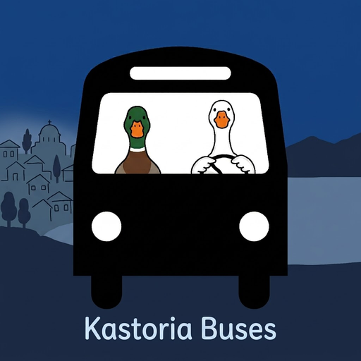
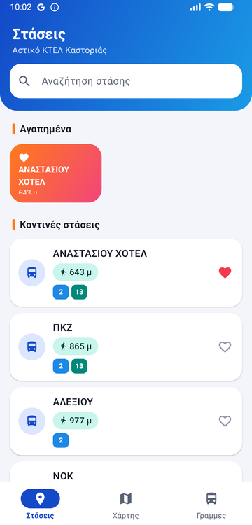
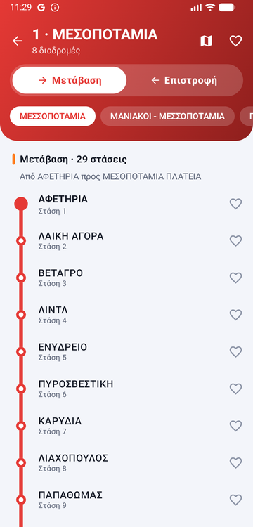
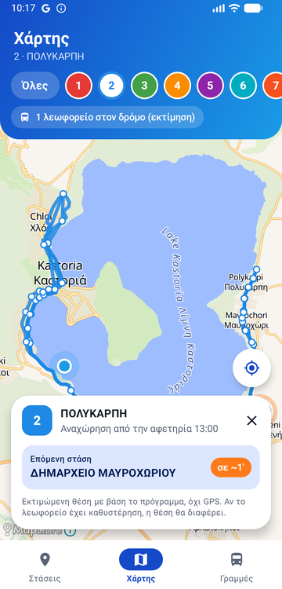
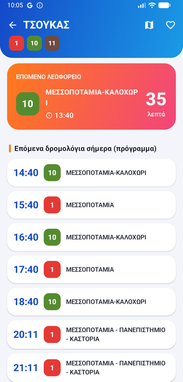
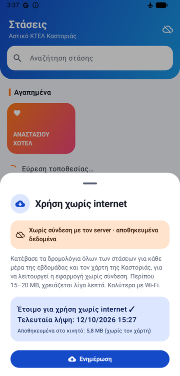

<p align="center">
  
</p>

<h1 align="center">Kastoria Bus</h1>

<p align="center">
  An Android app for the city buses of Kastoria, Greece (Αστικό ΚΤΕΛ Καστοριάς):<br>
  stops, lines, timetables, a map, and where the buses are right now.
</p>

> 🇬🇷 **Στα ελληνικά:** Εφαρμογή Android για τα αστικά λεωφορεία της Καστοριάς, στο ύφος της
> εφαρμογής του ΟΑΣΘ. Κοντινές στάσεις, γραμμές με **Μετάβαση / Επιστροφή**, πρόγραμμα
> δρομολογίων, χάρτης, αγαπημένα, **εκτίμηση θέσης λεωφορείων** από το πρόγραμμα και
> **λειτουργία χωρίς internet**. Ελληνικά και αγγλικά.

<p align="center">
  
  
  
  
  
</p>

---

## Features

### 🚏 Stops
- **Nearest stops first** with the walking distance, using the phone's location.
- Without location permission (or when you're far from Kastoria) the stops are listed **A–Z**.
- **Search** that ignores Greek accents (`ντινη` finds `ΝΤΙΝΗ`).
- Each stop shows the coloured badges of the lines that stop there.

### 🚌 Lines
- All lines in number order, each with **its own colour** (the API gives every line the same grey, so the app picks a bright one per line).
- **Μετάβαση / Επιστροφή (outbound / return)** tabs on every line, with only the routes that run that way.
- The stops drawn like a **metro map**: a coloured line joining a circle for each stop.

### 🕒 Timetables
- For each stop: today's next departures from the timetable, with a big **"next bus"** card and a minute countdown.

### 🗺️ Map
- Every stop on an OpenStreetMap map (MapLibre + OpenFreeMap, no API key needed).
- Pick a line to draw its route, see only its stops, and watch its buses move.
- Tap a stop for its lines and next departures, or use the **my location** button.

### ❤️ Favorites
- A heart on every stop and line. Favorites appear in a colourful bar at the top of the Stops and Lines tabs and are saved on the phone.

### 🌍 Greek and English
- All texts in Greek (default) and English. Stop and line names come from the server in the phone's language.

---

## The "live" bus estimator

The citybus.gr server has a live GPS endpoint, but during development it never returned any buses.
So the app **estimates** where each bus should be **from the timetable**, and always labels it as an estimate.

How it works (`data/estimate/`):

1. The API gives timetables **per stop**, not per trip. For each route the app downloads the timetable of about
   **6 checkpoint stops** spread along the route (once a day, then cached).
2. At every stop of a route the trips appear in the same order (checked on the real data), so the
   *k*-th time at each checkpoint belongs to the *k*-th trip of the day. That rebuilds whole trips:
   *left at 13:00, stop 10 at 13:07, stop 27 at 13:17…*
3. Every stop is placed on the route drawing (distance along the route in metres).
4. Every few seconds, for the current time, the app finds the two checkpoints each running bus is between,
   assumes a steady speed between them, and puts the bus at that point on the route.
   The last stop has no time in the timetable, so its arrival is estimated from the trip's average speed.

This is pure maths on the phone: **no extra network requests** while the buses move.
Checked against the real timetable: at 13:17 the app said the 13:00 line 2 bus would reach
*ΔΗΜΑΡΧΕΙΟ ΜΑΥΡΟΧΩΡΙΟΥ* in about 1 minute; the timetable says 13:19.

**Limits:** it shows where a bus *should* be. A late or cancelled bus is not detected.

---

## Μετάβαση / Επιστροφή (outbound / return)

The API's route `direction` field does **not** mean outbound/return, and most main routes are a single
round trip *ΑΦΕΤΗΡΙΑ → village → ΑΦΕΤΗΡΙΑ*. So the app works it out from the stop positions
(`data/RouteDirections.kt`):

- starts in town, ends outside → all **Μετάβαση**; starts outside, ends in town → all **Επιστροφή**
- starts and ends in town → a round trip, split at the **halfway point of the distance travelled**
  (the stop farthest from the centre doesn't work around the lake: on line 2, Κρεπένι is farther than Πολυκάρπη itself)
- never more than 1.5 km from the centre → a town loop, not split

Checked on all 47 routes (line 1 turns at ΜΕΣΟΠΟΤΑΜΙΑ ΠΛΑΤΕΙΑ, line 2 at ΠΟΛΥΚΑΡΠΗ ΤΕΡΜΑ, line 4 at ΠΑΝΕΠΙΣΤΗΜΙΟ…).

---

## Offline mode

The app keeps working **without internet**, and also when the server is down (this happened during
development: `/stops` answered with an empty body for hours, and the website was broken too).

- **Everything is saved automatically.** Each answer from the server is kept on the phone. The app reads in this order:
  memory → saved copy (if less than 7 days old) → internet → saved copy (even if old) → copy built into the app.
  Fresh saved data is used without asking the server at all, which is faster and gentler on it.
- **"Χρήση χωρίς internet" (use without internet).** The cloud button at the top right downloads everything in about
  2 minutes: every stop's timetable for **all 7 days** (~1,500 small requests, at most 3 at a time) and the
  **map of the Kastoria area** (a MapLibre offline region). About 6 MB plus the map.
- **Built-in starter pack.** The stops, lines and route stop lists ship inside the app (`assets/starter`, 65 KB),
  so it works even on the very first launch with no internet.
- While saved data is shown, the cloud at the top right is **crossed out**.

Offline, everything works: nearest stops (GPS doesn't need internet), lines, timetables, the map, favorites and the estimated buses.

---

## How it gets the data

The data comes from the API behind <https://kastoria.citybus.gr/el/stops> (`https://rest.citybus.gr`, agency `115`).
There is no login: the site writes a short-lived token (a JWT, ~48 hours) into the page's HTML. The app reads it from
the page, keeps it until it expires, and fetches a new one if the server answers 401. The token is never stored in the code.
All endpoints and quirks are documented in [`app/kastoria-api-notes.txt`](app/kastoria-api-notes.txt).

> ⚠️ This is an unofficial app. The data belongs to KTEL Kastoria / e-analysis.eu, and permission will be asked
> before publishing it anywhere.

---

## Tech

| | |
|---|---|
| Language / UI | Kotlin, Jetpack Compose, Material 3 |
| Navigation | Navigation Compose (Stops, Map, Lines tabs) |
| Network | Retrofit + OkHttp + Gson |
| Map | MapLibre Android (`android-sdk-opengl`) with OpenFreeMap tiles |
| Location | Android `LocationManager` (no Google Play Services) |
| Offline | JSON files on the phone + MapLibre offline region |
| Min Android | 8.0 (API 26) |

### Project structure

```
app/src/main/java/com/the09/kastoriabus/
├── data/
│   ├── remote/          API interface, token from the web page, 401 handling
│   ├── estimate/        the bus position estimator (route plans, geometry)
│   ├── BusRepository    the one place screens get data from (cache + offline)
│   ├── RouteDirections  Μετάβαση / Επιστροφή
│   ├── DiskCache, StarterPack, OfflineDownloader, OfflineMapDownloader
│   └── FavoritesStore, LocationHelper
└── ui/
    ├── stops/  lines/  linedetail/  stopdetail/  map/  offline/
    ├── common/          shared pieces: headers, cards, line colours
    └── theme/           colours (lake blue, sunset orange, teal)
```

---

## Build and run

1. Open the project in **Android Studio**.
2. Pick an emulator or a phone (with *USB debugging* on) and press **Run ▶**.

Unit tests (31, for the token, JSON parsing, the estimator, directions, offline cache and starter pack):

```
./gradlew testDebugUnitTest
```

App icon: replace `design/icon.jpg` and run `python design/make_icons.py` (needs Pillow). It makes the adaptive icon,
the themed icon for Android 13+, every density, and `design/play_store_icon_512.png` for Google Play.

---

## Roadmap

- [x] Stops, lines, timetables, favorites
- [x] Map with route shapes
- [x] Estimated bus positions
- [x] Μετάβαση / Επιστροφή
- [x] Offline mode
- [x] App icon
- [ ] Timetable for any day of the week on the stop screen
- [ ] Real GPS positions when the live endpoint returns data
- [ ] Check dark mode
- [ ] Ask KTEL Kastoria for permission, then publish on Google Play
